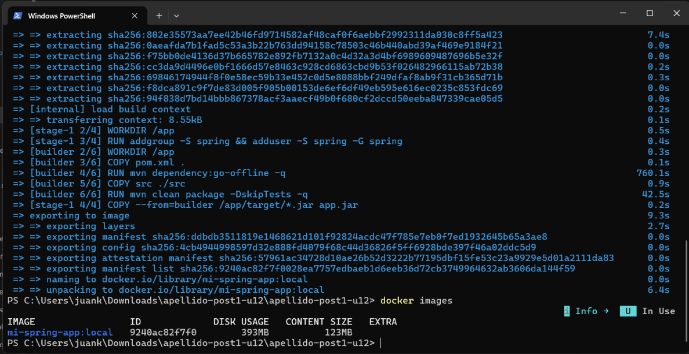
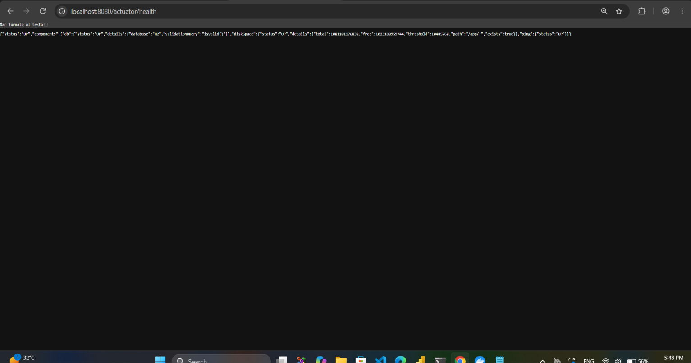
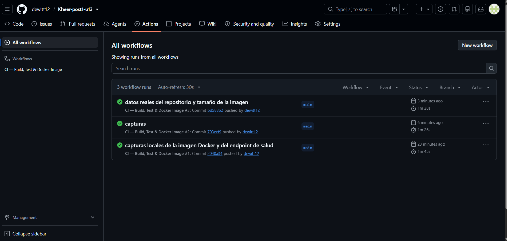
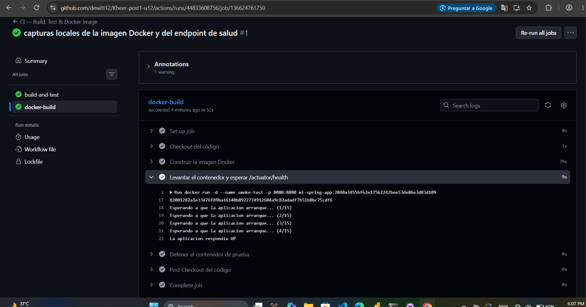
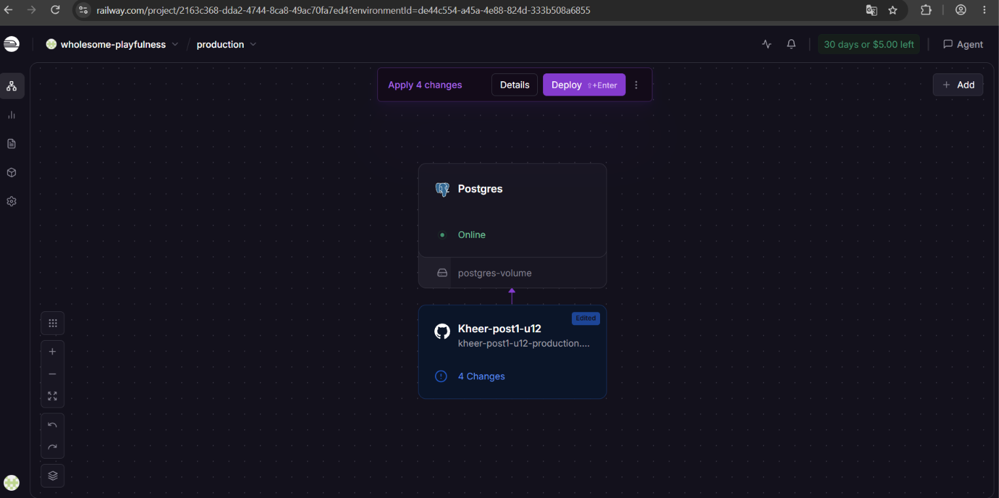
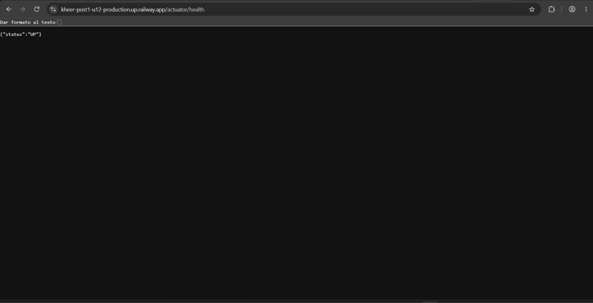

# Post-contenido — Unidad 12: Despliegue y CI/CD

## Descripción
Repositorio del laboratorio de la Unidad 12 de Programación Web.
Contiene una aplicación Spring Boot (CRUD de Producto) dockerizada con un
Dockerfile multi-stage y perfiles dev/prod (Parte 1), extendida con un
pipeline de integración continua con GitHub Actions y monitoreo con Spring
Boot Actuator (Parte 2).

## Parte 1 — Dockerización con Perfiles y Variables de Entorno
El Dockerfile multi-stage compila el proyecto con Maven en una etapa JDK y
ejecuta el JAR resultante en una etapa JRE Alpine con un usuario no root.
La configuración sensible se externaliza con placeholders `${VAR:default}`:
sin variables de entorno la aplicación arranca con el perfil `dev` (H2 en
memoria); con `SPRING_PROFILES_ACTIVE=prod` y las variables `DATASOURCE_URL`,
`DATASOURCE_USER` y `DATASOURCE_PASSWORD` arranca con la configuración de
producción (PostgreSQL).

| Variable | Perfil | Valor por defecto |
|---|---|---|
| `SPRING_PROFILES_ACTIVE` | ambos | `dev` |
| `PORT` | ambos | `8080` |
| `DATASOURCE_URL` | dev / prod | `jdbc:h2:mem:devdb` / `jdbc:postgresql://localhost:5432/appdb` |
| `DATASOURCE_USER` | dev / prod | `sa` / `appuser` |
| `DATASOURCE_PASSWORD` | dev / prod | vacío |
| `DDL_AUTO` | prod | `update` |

## Parte 2 — Pipeline CI/CD con GitHub Actions y Monitoreo con Actuator
El pipeline (`.github/workflows/ci.yml`) se activa en cada push o pull request
a `main` y tiene dos jobs encadenados con `needs:`:

1. **build-and-test**: compila con Maven (con caché de dependencias), ejecuta
   las pruebas (`mvn clean verify`) y publica el reporte de Surefire como
   artefacto.
2. **docker-build**: construye la imagen con el mismo Dockerfile, levanta el
   contenedor dentro del runner y hace un smoke test: consulta
   `/actuator/health` hasta 15 veces (2 s entre intentos) y exige `"status":"UP"`.
   Siempre elimina el contenedor al terminar (`if: always()`). No publica la
   imagen en ningún registro.

## Despliegue (paso final manual)
Desplegado en Railway/Render a partir del mismo Dockerfile, con las variables
de entorno configuradas en el panel de la plataforma:
- URL de la aplicación: https://TU-APP.up.railway.app
- Health: https://TU-APP.up.railway.app/actuator/health

## Decisiones de diseño

### Parte 1
1. **Placeholders con valor por defecto (`${VAR:default}`)** en vez de
   placeholders estrictos: el mismo artefacto arranca sin fricción en local y
   en CI; en producción cada valor se sobrescribe con variables de entorno.
2. **`application-dev.properties` y `application-prod.properties` separados**
   en vez de un solo archivo con bloques condicionales: hace explícito qué
   configuración corresponde a cada ambiente y reduce errores.
3. **Imagen final `eclipse-temurin` JRE Alpine** en vez de distroless: reduce
   el tamaño sin perder la posibilidad de depurar con `docker exec`.
4. **Etapa de build con la imagen `maven:3.9-eclipse-temurin-21-alpine`**:
   la imagen base de Temurin no incluye Maven.

### Parte 2
1. **Prueba mínima de contexto** en vez de omitir las pruebas: garantiza que
   el job de CI valide algo real (el contexto de Spring con el perfil dev).
2. **El job docker-build no publica la imagen**: evita exigir una cuenta
   externa y Secrets; el smoke test valida que la imagen arranca y responde
   saludable.
3. **Exposición de Actuator diferenciada por perfil** (todos los endpoints en
   dev; solo `health` e `info` en prod): evita exponer información sensible.
4. **`ddl-auto=update` configurable (`DDL_AUTO`) en prod**: permite crear las
   tablas en una base de datos vacía de Railway/Render; en un proyecto real
   se reemplazaría por migraciones (Flyway/Liquibase) con `validate`.

## Cómo compilar y ejecutar
1. Clonar: `git clone https://github.com/dewitt12/kheer-post1-u12.git`
2. Construir la imagen: `docker build -t mi-spring-app:local .`
3. Perfil dev (valores por defecto):
   `docker run -p 8080:8080 mi-spring-app:local`
4. Perfil prod (con PostgreSQL local vía Docker Compose):
   `docker compose up --build`
   o manualmente:
   `docker run -p 8080:8080 -e SPRING_PROFILES_ACTIVE=prod -e DATASOURCE_URL=jdbc:postgresql://host.docker.internal:5432/appdb -e DATASOURCE_USER=appuser -e DATASOURCE_PASSWORD=apppass mi-spring-app:local`
5. Verificar: `curl http://localhost:8080/actuator/health`
6. Pipeline: pestaña **Actions** del repositorio.

## Capturas de pantalla

